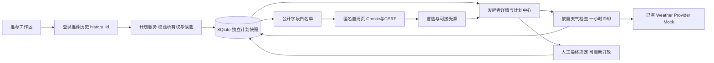

# 同行计划：本地启动与比赛演示

日期：2026-10-06。此功能为当前实验分支的未提交实现。新增开发由 Codex 完成，不属于湛卢平台开发记录；已有候选对比与 P0 的湛卢证据仍应单独保留。

当日运行更新：用户确认并批准升级 `data-competition-demo`，已保留本地备份、验证副本后把原演示库升级至 0005，业务记录摘要不变。当前 Mock 后端 8000 / Vite 前端 5173 已后台启动，health 与代理均 200。默认 data 库未修改；新关闭/历史回流仍待用户人工操作和浏览器 E2E 验收。备份目录 `data-competition-demo/backups/before-0005-20261006-201314/` 含私人数据，不提交或打包上传。

## 演示模式

FastAPI + SQLite + Vite + 系统 Chrome。不需要 Docker、Railway、真实第三方 API 或新增下载。用户已告知 Railway 到期，本轮没有核查或重新部署远程环境。

账户、计划持久化、邀请、匿名身份、投票与状态转换是真实本地业务；地点与天气是 Mock 演示数据。Mock 通过不能表述为真实天气、Live 或多人公网协作已验证。

## 使用已有环境启动

后端在一个普通 PowerShell 窗口运行：

```powershell
Set-Location 'C:\Users\24188\Desktop\智能化软件工程师夏令营\RoamBot'
$env:ROAMBOT_PROVIDER_MODE = 'mock'
$env:ROAMBOT_DEMO_MODE = 'true'
$env:ROAMBOT_SECURE_COOKIES = 'false'
$env:ROAMBOT_DATA_DIR = 'data-competition-demo'
.\.venv\Scripts\python.exe -m uvicorn roambot.main:app --app-dir backend/src --host 127.0.0.1 --port 8000
```

新演示目录与原 `data` 分开；请始终保留同一演示目录以找回账户和计划。启动会初始化缺失表，不删除旧数据。正式升级前停止写入并备份数据；本轮迁移验证只使用测试数据库。

**已有计划数据库升级注意**：`create_all` 不会把旧 CHECK 从 voting/decided 改为允许 closed。全新数据库使用最新 ORM；已有数据库须停写、备份、审核版本及 schema 后迁移到 0005。已记录 0004 的数据库可在副本验证标准升级；没有 `alembic_version` 的演示库不能直接盲目 upgrade/stamp，需先审核是否符合迁移基线。本次尚未操作用户数据库，重启本身不代表此升级已完成。不要删除旧数据库、换目录来伪装“升级成功”。

前端另开 PowerShell：

```powershell
Set-Location 'C:\Users\24188\Desktop\智能化软件工程师夏令营\RoamBot\frontend'
node node_modules/vite/bin/vite.js --host 127.0.0.1 --port 5173
```

直接调用 Vite 避开当前机器曾出现的 npm 不在 PATH 问题。Node 必须先能运行 `node --version`；本轮使用 Node 24.19.0 和 Python 3.12.14，不重新安装环境。

入口：[http://127.0.0.1:5173](http://127.0.0.1:5173)。健康检查：[http://127.0.0.1:8000/api/v1/health](http://127.0.0.1:8000/api/v1/health)。两窗口各按 Ctrl+C 停止，不删除演示目录。若端口已被使用，先确认旧进程归属，不盲目结束其他服务。

本配置仅绑定回环地址。第二台手机不能直接访问电脑的 localhost；手机适配目前通过 390×844 Chrome 视口验证，不等于真实手机网络验证。不要为演示临时开放公网或修改防火墙。

## 人工验收顺序

1. 推荐苏州，出发地苏州站，未来一天，80 km，勾选湖景、博物馆；确认演示数据提示。
2. 勾选两个候选，查看对比；普通游客到此可以结束，不强迫创建计划。
3. 在左侧选中至少两个地点，点击对比入口下方的“创建同行计划”，注册/登录；游客结果必须明确点击“更新推荐”，检查候选后再创建。输入名称、预计人数 2。
4. 在详情生成邀请。用另一个无痕窗口打开；完整链接仅用于这次操作，不录入截图或材料。
5. 昵称加入；投票前看不到汇总；投票后查看汇总，并直接修改一次、不刷新测试改票。
6. 发起者刷新查看票数，检查天气并提交自己的票；点击“结束投票”，确认后进入“待决定”。确认原票数保留，同行者刷新后不能投票/改票。
7. 发起者可在待决定状态确定地点或重新开放；重开保留原票，决定后邀请页显示最终地点。计划中心可找回，顶部状态显示最近出行计划；待决定卡片入口为“决定目的地”。
8. 再次登录同一发起者账户验证找回；匿名同行者须保留同一浏览器 Cookie。清除 Cookie 后不能恢复匿名身份。
9. 桌面检查 hover/键盘聚焦展开、其他导航不移动；手机检查两行导航与单列内容。结束后隐藏顶部状态仍需人工补查。
10. 从“历史”的更多操作点击“重新查询”，应回到推荐左右工作区，摘要为该次历史的原条件、结果为新的查询；点击历史记录本身仍打开只读快照。

上述新增关闭/历史回流仅单元/API测试通过，本轮浏览器 E2E 文件已更新但未运行，需重新验收，不复用旧通过结果。

## 架构与可信数据流



投票不重算原推荐分；天气检查独立存储，不覆盖历史快照。发起者接口与匿名接口分别校验权限。邀请和匿名身份只存哈希；访问日志对邀请路径脱敏，页面禁用 referrer。

## 3～5 分钟视频脚本（待实际录制）

| 时间 | 画面与讲解 |
|---|---|
| 0:00–0:30 | 真实问题：推荐多个地点后，同行者仍需在聊天里反复讨论。展示普通推荐可独立完成。 |
| 0:30–1:10 | 填条件、两个候选对比，说明天气、路程、公平性与未知评分不伪造。显式标明 Mock。 |
| 1:10–1:50 | 登录后确认重新推荐、创建可信计划；后台依据账户历史而非浏览器回传分数。 |
| 1:50–2:40 | 匿名窗口加入、先投后看、改票；不展示完整邀请链接或 Cookie。 |
| 2:40–3:20 | 发起者刷新汇总、检查天气、明确最终决定，邀请转为只读。 |
| 3:20–4:00 | 桌面胶囊与移动端、计划中心；介绍可重复测试和真实 RED/GREEN 修正。 |
| 4:00–4:30 | 限制：本地 Mock、Live 未验证、匿名身份不支持找回、无聊天/预订/自动决策。 |

不要把脚本写成“视频已完成”。录屏使用演示账户，隐藏地址栏邀请令牌和详情中的复制框，不录私人出发地或账户密码。

## PPT 建议 7 页（大纲，非完成的 PPT 文件）

1. RoamBot 定位与多人决策问题。
2. 暑期已有功能、湛卢候选对比/P0、Codex 同行计划的贡献边界。
3. 普通推荐与可选同行计划两条流程。
4. 上述架构、可信历史、隐私白名单与权限。
5. 桌面/手机截图、先投后看、最终决定。
6. 实际测试报告、环境排查、AI 修改与人工审查证据。
7. 应用价值、未验证内容、后续部署和限制。

## 备用与边界

- 外网失败：本地 Mock 不需要真实 Provider；不临时启用 Live。
- 演示进程失败：先使用已脱敏截图与后续录好的本地视频，说明不是当前实时运行。
- 匿名 Cookie 丢失：换昵称重新加入，发起者移除重复成员；不能声称有匿名身份恢复。
- 票数不会实时推送：刷新详情获取最新结果。
- 多个匿名标签页可能刷新 CSRF：按错误提示刷新对应邀请再改票。
- SQLite 单服务/小规模演示定位；Live 慢请求下的锁等待、高并发、公网部署及真实手机尚未验证。
- 当前无独立代码审查者，仍需用户人工验收；未经批准不提交、推送或部署。

测试结果与具体执行记录见 [CODEX_PLAN_IMPLEMENTATION.md](CODEX_PLAN_IMPLEMENTATION.md)。截图位于 `docs/competition/evidence/`，都是自动化 Mock 截图，不是用户人工验收证据。
